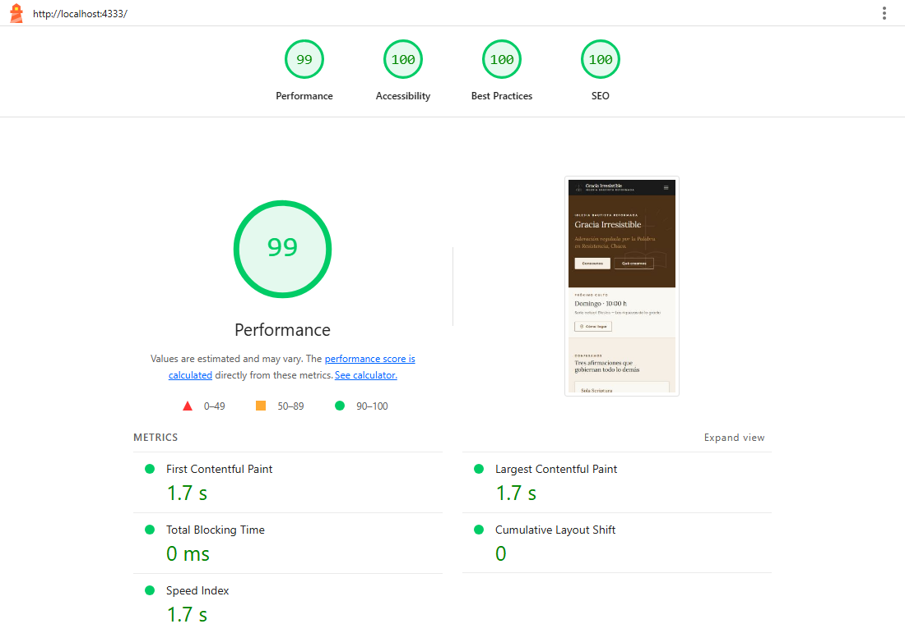

# Iglesia Bautista Reformada «Gracia Irresistible» — sitio web

Sede digital de la Iglesia Bautista Reformada «Gracia Irresistible» (Resistencia,
Chaco). Sitio estático, sobrio y confesional, construido según el Manual de
Identidad de Marca v1.0 (Edición 2026).

- **Framework:** [Astro](https://astro.build) 7 (salida estática, cero JS por defecto).
- **Estilos:** Tailwind CSS 4 (vía `@tailwindcss/vite`) + tokens de marca en CSS variables.
- **Tipografías:** self-hosted con `@fontsource/lora` y `@fontsource/poppins` (nunca CDN de Google).
- **Contenido:** colecciones MDX/Markdown con schemas de Zod (`sermones`, `series`, `liderazgo`).
- **Íconos:** SVG inline estilo Lucide (sin librería, para mantener cero JS).
- **Mapa:** OpenStreetMap embebido en escala de grises (sin Google, sin trackers).
- **Analytics:** ninguno incluido. Si se agrega, usar Plausible o Umami self-hosted (nunca Google Analytics / Meta Pixel).

---

## Requisitos

- Node.js **≥ 22.12** (probado con Node 24 LTS).
- npm 10+.

## Puesta en marcha

```bash
npm install
npm run dev        # servidor de desarrollo en http://localhost:4321
```

Otros comandos:

```bash
npm run build      # genera el sitio estático en dist/
npm run preview    # sirve dist/ localmente
node scripts/generate-og.mjs   # regenera public/og-default.png (portada Open Graph)
```

---

## Estructura del proyecto

```
src/
├── components/
│   ├── brand/        Emblem, Seal, Logo (identidad SVG monocroma)
│   ├── ui/           Container, Eyebrow, Divider, Watermark, Button, Card, Link,
│   │                 Display/H1–H3/Body/Cita, Verse, Callout, Accordion, HubCard,
│   │                 Section, TwoColumn, PageHero, Icon
│   ├── layout/       Header, Footer
│   ├── media/        Placeholder (fase desarrollo), MapEmbed (OpenStreetMap)
│   ├── sermones/     SermonCard, SermonPlayer
│   ├── somos/        LeaderCard, ValueCard
│   └── creemos/      SolaBlock, TulipPoint
├── content/          sermones/  series/  liderazgo/   (Markdown + MDX)
├── content.config.ts colecciones y schemas Zod
├── data/iglesia.ts   FUENTE ÚNICA de datos institucionales (ver CONTENT.md)
├── layouts/Layout.astro   layout base con SEO (OG + Twitter + JSON-LD)
├── pages/            todas las rutas (ver más abajo)
├── styles/global.css tokens de marca, escala tipográfica, utilidades
└── utils/format.ts   formateo de fechas y duraciones
```

### Rutas

```
/                         Home
/somos  · /somos/historia · /somos/mision-y-vision · /somos/liderazgo · /somos/membresia
/creemos · /creemos/confesion-1689 · /creemos/cinco-solas
         · /creemos/doctrinas-de-la-gracia · /creemos/que-somos-que-no-somos
/predicacion · /predicacion/serie-actual · /predicacion/archivo
             · /predicacion/[slug] · /predicacion/recursos
/contacto · /gracias · /404
/design-system            Referencia interna del sistema de diseño (no listada en el menú, noindex)
/robots.txt · /sitemap-index.xml
```

---

## Tareas frecuentes

Todo el detalle está en **[CONTENT.md](CONTENT.md)**. En resumen:

- **Cambiar el próximo culto, horarios, dirección o redes:** editá `src/data/iglesia.ts`.
- **Agregar un sermón:** creá un `.mdx` en `src/content/sermones/` (ver plantilla en CONTENT.md).
- **Agregar una serie:** creá un `.md` en `src/content/series/`.
- **Agregar liderazgo:** creá un `.md` en `src/content/liderazgo/`.
- **Reemplazar placeholders por fotos reales:** buscá los comentarios `PLACEHOLDER:` en el código.

---

## Despliegue

El sitio es estático (`dist/`), desplegable en Netlify o Cloudflare Pages.

- **Netlify:** el `netlify.toml` incluido define `npm run build` y `dist` como
  publish directory. El formulario de contacto usa **Netlify Forms** (atributo
  `data-netlify` + honeypot `bot-field`); Netlify lo detecta automáticamente en el
  HTML generado. Tras enviar, redirige a `/gracias`.
- **Cloudflare Pages:** build command `npm run build`, output `dist`. Para el
  formulario, reemplazar el endpoint por Cloudflare Forms/Function.

Dominio final: **graciairresistible.org** (configurar `site` en `astro.config.mjs`
si cambia).

### Archivos de audio y PDF

Las rutas `audioUrl`, `pdfNotas` y los recursos apuntan a `/audio/…`, `/notas/…`
y `/recursos/…`. Colocá los archivos reales bajo `public/audio/`, `public/notas/`
y `public/recursos/`. Mientras no existan, los enlaces de descarga apuntarán a
rutas vacías (no afectan el rendimiento ni la carga de la página).

---

## Rendimiento y accesibilidad

Objetivo del manual: Lighthouse ≥ 95 en todas las métricas. Resultado medido
sobre el build de producción (`npm run preview`), Chrome headless:

| Página | Performance | Accessibility | Best Practices | SEO |
|---|---|---|---|---|
| Home | 100 | 100 | 100 | 100 |
| Somos · Misión y visión | 100 | 100 | 100 | 100 |
| Creemos · Cinco Solas | 100 | 100 | 100 | 100 |
| Creemos · Doctrinas de la gracia | 100 | 100 | 100 | 100 |
| Predicación · Sermón | 100 | 100 | 100 | 100 |
| Contacto | 100 | 100 | 100 | 100 |
| Somos · Liderazgo | 100 | 100 | 100 | 100 |



Para reproducir:

```bash
npm run build
npm run preview   # en otra terminal
npx lighthouse http://localhost:4321/ --view
```

Notas de accesibilidad:

- Contraste WCAG AA como mínimo. El oro antiguo (`#B8935A`) y la piedra
  (`#78716C`) son mid-tones que no cumplen AA como texto pequeño; para eso se usan
  variantes derivadas (`--color-oro-texto`, `--color-piedra-texto`) mientras los
  colores de identidad se conservan intactos para ornamento y bloques grandes.
- Navegación por teclado con foco visible en sepia; `prefers-reduced-motion` respetado.
- HTML semántico, un único `<h1>` por página y jerarquía de encabezados sin saltos.

---

## Principios (no negociables)

1. Contenido antes que decoración. La tipografía es el diseño.
2. Mobile first (se prueba a 375 px primero).
3. Accesible y rápido. Sin JS pesado.
4. Sin captura de datos innecesaria. Sin cookies de terceros.
5. Voz institucional, reformada y confesional. Nada de lenguaje de marketing o
   autoayuda cristiana.

Ante la duda, elegí lo más sobrio, no lo más impactante.

> *«Todo lo que hacéis, sea de palabra o de hecho, hacedlo todo en el nombre del
> Señor Jesús, dando gracias a Dios Padre por medio de Él.»* — Colosenses 3:17
